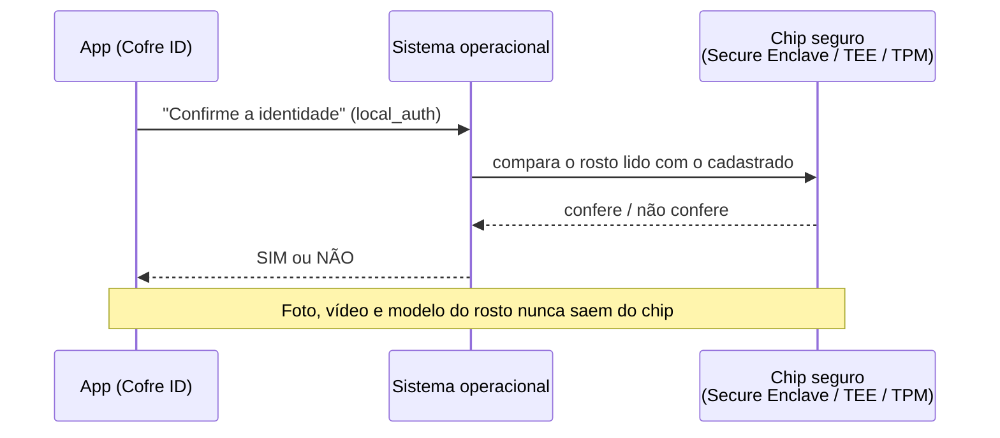
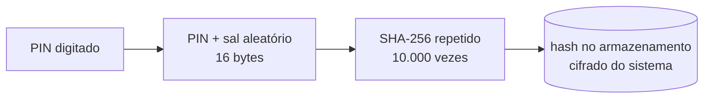
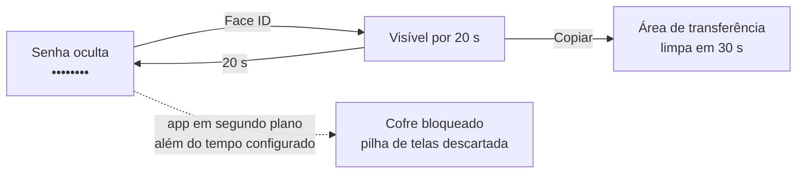
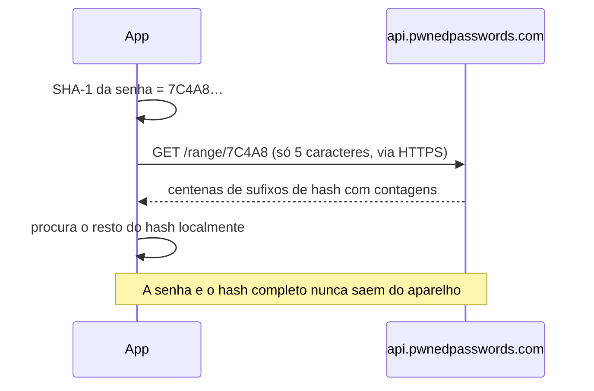
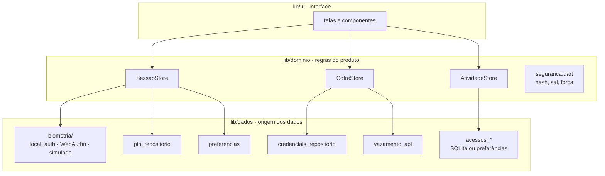

# 🔐 Cofre ID

**Um cofre de senhas que só abre com o seu rosto.**
Trabalho de LDDM (Laboratório de Desenvolvimento de Dispositivos Móveis), tema **Segurança**.


O Cofre ID guarda contas e senhas e só libera cada uma depois de provar que é
você: **Face ID** (ou a biometria do aparelho), com **PIN** como chave de
reserva. O objetivo do trabalho é mostrar, na prática, como um app moderno faz
autenticação biométrica de forma segura e o que mais é preciso em volta dela.

<!--
Para adicionar capturas de tela: salve as imagens em docs/img/ e descomente.

| Bloqueio | Cofre | Detalhe | Histórico |
|---|---|---|---|
|  |  |  |  |
-->

## Sumário

- [O que o app faz](#o-que-o-app-faz)
- [Como a segurança funciona](#como-a-segurança-funciona)
- [Como rodar](#como-rodar)
- [Arquitetura](#arquitetura)
- [Onde cada dado é guardado](#onde-cada-dado-é-guardado)
- [Conceitos das aulas](#conceitos-das-aulas)
- [Testes](#testes)
- [Roteiro de apresentação](#roteiro-de-apresentação)
- [Limitações](#limitações)

## O que o app faz

| Recurso | Como funciona |
|---|---|
| **Desbloqueio por Face ID** | Ao abrir, o app já começa a escanear o rosto, com animação de varredura. Se falhar, oferece o PIN. |
| **Reautenticação** | Mesmo com o cofre aberto, revelar, copiar ou excluir uma senha pede o Face ID de novo. |
| **Exposição mínima** | A senha revelada some em 20 s, a área de transferência é limpa em 30 s e o cofre tranca ao sair do app. |
| **Anti força bruta** | 5 PINs errados bloqueiam o PIN por 30 s, e a contagem sobrevive a fechar o app. |
| **Gerador e força de senha** | Gera senhas de 16 caracteres com gerador criptográfico e mostra a força em tempo real. |
| **Verificação de vazamentos** | Consulta o *Have I Been Pwned* sem revelar a senha (anonimato-k). |
| **Histórico de acessos** | Toda tentativa, liberada ou negada, fica registrada. |
| **Modo demonstração** | Simula o Face ID em computadores sem biometria, com aviso permanente na tela. |

## Como a segurança funciona

### 1. O app nunca vê o seu rosto



Quem compara o rosto é o sistema, dentro de um chip isolado. O app só recebe a
resposta. Se o app for comprometido, a biometria não vaza, porque nunca esteve
nele.

- **Android:** `BiometricPrompt` · **iPhone:** Face ID · **Windows:** Windows Hello.
- **Navegador:** WebAuthn (a tecnologia das passkeys). A chave privada fica presa
  no hardware e o app guarda só o ID público da credencial.
- Cada falha do sistema vira um enum do domínio (`sucesso`, `falhou`, `cancelado`,
  `indisponivel`, `bloqueado`). Cancelar não conta como falha de segurança, mas
  um rosto não reconhecido vai para o histórico.

### 2. O PIN nunca é guardado



- **Sal aleatório:** o mesmo PIN gera hashes diferentes em usuários diferentes, e
  tabelas prontas de hashes (*rainbow tables*) não servem.
- **10.000 repetições:** cada palpite do atacante passa a custar 10 mil hashes.
- **Comparação em tempo constante:** o tempo de resposta não revela quantos
  caracteres estavam certos (ataque de temporização).
- **PIN fraco é recusado:** repetidos (`111111`), sequências (`123456`, `654321`)
  e uma lista de PINs comuns.

### 3. Proteção contra força bruta

Após **5 PINs errados**, o teclado trava por **30 s** com contagem regressiva. O
número de erros e o horário do desbloqueio ficam no armazenamento cifrado:
**fechar e reabrir o app não zera as tentativas.**

### 4. Senhas cifradas pelo sistema

As senhas e o hash do PIN usam `flutter_secure_storage`: Android Keystore
(RSA-OAEP + AES-GCM), iOS Keychain, Windows (proteção do sistema) e WebCrypto no
navegador. **Nenhum segredo vai para o SQLite**, porque o arquivo `.db` não é
criptografado. A lista de contas (serviço e usuário) fica separada das senhas,
então a tela do cofre é desenhada sem ler nenhuma senha.

### 5. Exposição mínima



- O app observa o ciclo de vida: ao ficar em segundo plano por mais que o tempo
  configurado (imediato, 30 s, 1 min ou 5 min), ele tranca.
- Ao trancar, a lista sai da memória e **toda a pilha de telas é descartada**
  (`pushNamedAndRemoveUntil`). Nada do cofre fica por baixo.
- O diálogo do Face ID pausa o app no celular. Isso não conta como "saiu do app".
- No Android, o backup do Google está desligado para o app (`allowBackup=false`).

### 6. Reautenticação em ações sensíveis

Pedem o Face ID de novo: **revelar**, **copiar**, **excluir** uma senha,
**verificar vazamento**, **desligar o Face ID**, **limpar o histórico** e
**apagar todos os dados**. Desligar uma proteção também exige provar quem você é.

### 7. Verificação de vazamentos com anonimato-k



A tela trata os quatro estados da Aula 10: parado, carregando, resultado e erro
(com timeout de 10 s).

### 8. Auditoria

Todo acesso vira um registro (método, horário e motivo), liberado ou negado.
Apagar o histórico exige Face ID, então um invasor não esconde o que fez.

### Modelo de ameaças

| Ameaça | Defesa |
|---|---|
| Alguém pega o celular desbloqueado | Face ID a cada senha e bloqueio automático |
| Adivinhar o PIN | 5 tentativas, bloqueio de 30 s e recusa de PIN fraco |
| Copiar os arquivos do app | Senhas cifradas pelo sistema, nunca em arquivo aberto |
| Olhar por cima do ombro | Senha oculta e que some sozinha em 20 s |
| Outro app lendo a área de transferência | Limpeza automática em 30 s |
| Senha já vazada | Consulta anônima a base de vazamentos |
| Apagar os rastros | Limpar o histórico exige Face ID |

## Como rodar

Pré-requisito: [Flutter](https://docs.flutter.dev/get-started/install) 3.47 ou
mais recente (Dart 3.13).

```bash
git clone https://github.com/gabrielteotonio10/Aplica-o-mobile-seguran-a.git
cd Aplica-o-mobile-seguran-a
flutter pub get
```

| Onde | Comando | Biometria usada |
|---|---|---|
| Chrome | `flutter run -d chrome --web-port 5000` | Windows Hello / Touch ID pelo navegador (WebAuthn) |
| Android (celular ou emulador) | `flutter run` | Rosto ou digital do aparelho |
| iPhone ou simulador iOS (precisa de Mac) | `flutter run` | Face ID |
| Qualquer lugar | Ajustes → **Modo demonstração** | Face ID simulado |

> **No Chrome, use sempre a mesma porta** (`--web-port 5000`). O navegador guarda
> os dados por endereço: mudando a porta, o app começa do zero. A WebAuthn só
> funciona em `localhost` ou HTTPS.

**Emuladores**
- *Simulador do iPhone:* menu **Features → Face ID → Enrolled**. Para testar, use
  *Matching Face* (reconhece) ou *Non-matching Face* (falha).
- *Emulador Android:* cadastre uma digital em Configurações → Segurança e use
  *Extended controls → Fingerprint → Touch sensor*.

## Arquitetura

Três camadas, em que cada uma só conhece a de baixo (Aula 08):



```
lib/
├── main.dart                          monta as lojas (Provider) e abre o app
├── dados/
│   ├── biometria/                     contrato + local_auth, WebAuthn e simulação
│   ├── pin_repositorio.dart           hash do PIN e tentativas (armazenamento cifrado)
│   ├── credenciais_repositorio.dart   senhas (armazenamento cifrado)
│   ├── acessos_*.dart                 histórico (SQLite ou shared_preferences)
│   ├── preferencias.dart              ajustes (shared_preferences)
│   └── vazamento_api.dart             Have I Been Pwned (http)
├── dominio/
│   ├── seguranca.dart                 hash, sal, comparação segura, força da senha
│   ├── sessao_store.dart              PIN, biometria, bloqueios
│   ├── cofre_store.dart               contas do cofre
│   ├── atividade_store.dart           histórico de acessos
│   └── credencial.dart · registro_acesso.dart
└── ui/
    ├── app.dart · rotas.dart · tema.dart · textos.dart
    ├── componentes/                   scanner do Face ID (CustomPainter), teclado de PIN...
    └── telas/                         bloqueio, cofre, detalhe, atividade, ajustes...
```

A troca de plataforma é invisível para as telas: no navegador a biometria vira
WebAuthn e, onde o `sqflite` não roda, o histórico usa `shared_preferences`.

## Onde cada dado é guardado

| Dado | Onde | Por quê |
|---|---|---|
| Senhas e hash do PIN | `flutter_secure_storage` | É segredo, e o sistema cifra. |
| Histórico de acessos | SQLite (`sqflite`) | Muitos registros iguais, que crescem. |
| Ajustes (biometria ligada, tempo de bloqueio) | `shared_preferences` | Pequenos, chave-valor e **não são segredo**. |

No navegador e no Windows o `sqflite` não roda, então o histórico usa
`shared_preferences`, limitado aos 100 acessos mais recentes.

## Conceitos das aulas

| Aula | Onde aparece |
|---|---|
| 03 · Dart | `enum` com campos, *records*, `switch` como expressão, `async`/`await` |
| 04 · Interfaces I | Tema `ColorScheme.fromSeed` com modo escuro; `Stack` + `Positioned` no cabeçalho do detalhe; `Expanded` nos indicadores |
| 05 · Interfaces II | `ListView.separated`; `StatefulWidget`/`setState`; `Form` com `validator` |
| 06 · Navegação | Rotas nomeadas; `pushReplacement` do bloqueio ao cofre; `push` com dado no construtor; `await push` + `pop(true)`; `NavigationBar` e `NavigationRail` |
| 07 · Estado compartilhado | `ChangeNotifier` + `Provider`; `watch` no build e `read` nos botões; `initState`/`dispose` |
| 08 · Camadas | `ui`, `dominio` e `dados`; repositórios; testes com repositório falso |
| 09 · Persistência local | `shared_preferences` e SQLite (`sqflite`) |
| 10 · API REST | `http` com os quatro estados da tela |
| 11 · Nuvem e offline-first | Decisão consciente de ficar **sem servidor**: o aparelho é a fonte da verdade |

## Testes

```bash
flutter test
dart analyze
```

São **25 testes**:

- **Regras de segurança (16):** hash e sal, comparação em tempo constante, PINs fracos recusados, força e gerador de senha.
- **Sessão (8):** PIN certo e errado, bloqueio por tentativas, bloqueio que sobrevive a reabrir o app, auditoria, ativação da biometria, modo demonstração e bloqueio automático.
- **Fluxo de primeiro uso (1):** teste de widget que recusa PIN fraco, cria o PIN e abre o cofre vazio.

A biometria e os repositórios são trocados por versões falsas (`test/falsos.dart`),
então nenhum teste precisa de sensor ou de internet.

> Se `flutter analyze` travar com `FormatException`, é o acento no caminho da
> pasta. Use `dart analyze`, que funciona.

## Roteiro de apresentação

1. **Primeiro uso:** tente o PIN `123456` (recusado por ser sequência) e crie um PIN válido.
2. **Ative o Face ID** (ou o modo demonstração, se o computador não tiver biometria).
3. **Nova senha:** `Gmail` / `senha123`. Mostre a barra "Muito fraca" e o botão **Gerar senha forte**.
4. **Abra o Gmail → Revelar.** Face ID → a senha aparece e some sozinha.
5. **Verifique o vazamento:** `senha123` aparece mais de 1 milhão de vezes.
6. **Ajustes → desligue "Rosto reconhecido"** → bloqueie. O Face ID falha, use o PIN e erre 5 vezes para ver o bloqueio de 30 s.
7. **Atividade:** o histórico mostra tudo, inclusive as falhas.
8. **Ajustes → Como funciona a segurança:** resumo das proteções.

## Limitações

- **O modo demonstração não é seguro.** Ele só simula o rosto, e o app avisa isso na tela o tempo todo. Não guarde senhas reais nele.
- **Um PIN de 6 dígitos tem só 1 milhão de combinações.** A proteção real vem do limite de tentativas e do armazenamento cifrado, e não do hash.
- **Sem servidor, a WebAuthn não é verificada.** Num sistema com servidor, ele conferiria a assinatura. Aqui o app confia na resposta do navegador, como o `local_auth` faz no celular.
- **A biometria real foi implementada com as APIs oficiais**, mas o teste ao vivo foi feito no navegador e no modo demonstração.
- **Ideias futuras:** bloqueio com tempo crescente, PBKDF2 ou Argon2 no lugar do SHA-256 repetido e sincronização na nuvem com regras de segurança.
